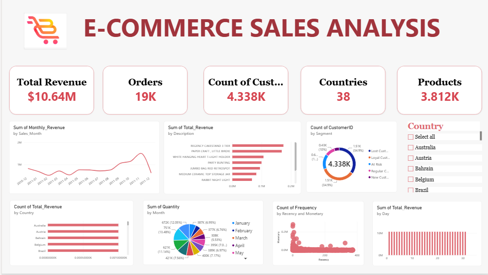

# E-Commerce Sales & Customer Analysis

An end-to-end Data Analytics project using Python, MySQL, and Power BI to analyse retail transactions, identify sales trends, evaluate product performance, and understand customer purchasing behaviour.

## Dashboard Preview



## Project Objectives

- Analyse retail sales and revenue trends.
- Identify top-performing products.
- Understand country-wise sales performance.
- Analyse customer purchasing behaviour.
- Perform RFM-based customer segmentation.
- Build an interactive Power BI dashboard.

## Tools & Technologies

- **Python:** Pandas, NumPy
- **SQL:** MySQL
- **Data Visualization:** Power BI
- **Data Preparation:** Python, Power Query
- **Environment:** Google Colab, MySQL Workbench

## Dataset

**Source:** [UCI Machine Learning Repository – Online Retail](https://archive.ics.uci.edu/dataset/352/online+retail)

- Original records: 541,909
- Cleaned records: 524,878
- Period: December 2010 – December 2011
- Currency: GBP (£)
- Business context: UK-based online retailer

## Data Cleaning

Performed data cleaning using Python:

- Removed 5,268 duplicate records.
- Removed 1,454 records with missing product descriptions.
- Filtered non-positive unit prices.
- Removed cancelled invoices.
- Handled missing Customer IDs appropriately.
- Created a Revenue column using Quantity × UnitPrice.

## Key Results

| Metric | Result |
|---|---:|
| Total Revenue | £10,642,110.80 |
| Total Quantity Sold | 5,572,420 |
| Transactions / Invoices | 19,960 |
| Identified Customers | 4,338 |
| Countries | 38 |
| Distinct Products (Stock Codes) | 3,812 |

## Analysis Performed

**Python Analysis**
- Exploratory Data Analysis
- Monthly sales analysis
- Product and country analysis
- Customer purchasing behaviour
- RFM customer segmentation

**SQL Analysis**
- Revenue and order analysis
- Monthly sales trends
- Top products by revenue and quantity
- Country-wise revenue
- Customer spending and frequency
- Repeat customer analysis
- CTEs and window functions
- Analytical SQL views

**Power BI Dashboard**
- Sales KPI cards
- Monthly revenue trend
- Top 10 products by revenue
- Customer segmentation
- Country-wise analysis
- Monthly quantity analysis
- Customer behaviour scatter plot
- Interactive country slicer

## RFM Analysis

Customer segmentation was performed using:

- **Recency:** Days since the customer's last purchase.
- **Frequency:** Number of distinct orders.
- **Monetary:** Total customer revenue.

Customers were grouped using project-defined RFM scoring rules.

## Repository Structure

```text
E-Commerce-Sales-Customer-Analysis/
│
├── Python/
│   ├── E-Commerce.ipynb
│   └── Customer_RFM_Analysis.csv
│
├── SQL/
│   └── Ecommerce_Analysis.sql
│
├── PowerBI/
│   └── Ecommerce_Sales_Customer_Analysis.pbix
│
├── dashboard.png
├── PROJECT_DOCUMENTATION.md
└── README.md
```

## Key Finding

November 2011 recorded the highest monthly revenue, while February 2011 recorded the lowest monthly revenue during the analysed period.

## Limitations

- The dataset covers a historical period.
- Product cost information is unavailable; therefore, profit analysis is outside the scope.
- RFM segmentation is descriptive and not a predictive model.

## Author

**Nidhi D**

B.Tech – Artificial Intelligence and Data Science

[LinkedIn](https://linkedin.com/in/nidhi-jain-9868652a3) | [GitHub](https://github.com/nidhijain8)
